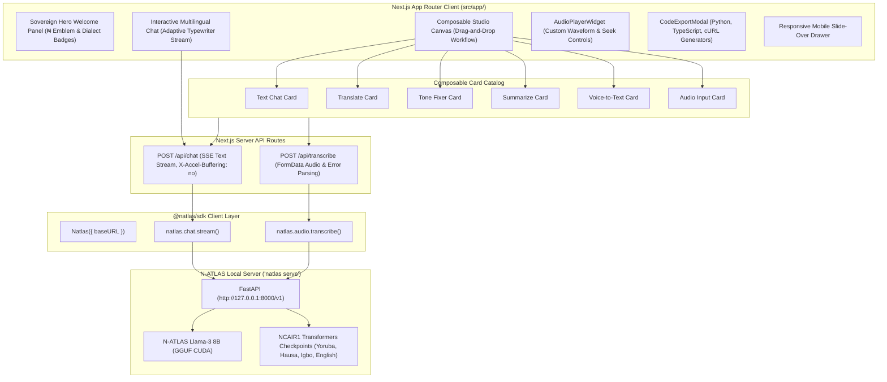

# N-ATLAS Sovereign AI Playground (Next.js)

[](https://nextjs.org)
[](https://www.typescriptlang.org)
[](https://tailwindcss.com)

The official web interactive demonstration playground and workflow studio for **N-ATLAS** (Nigeria's sovereign multilingual Large Language Model and Speech Recognition platform), powered directly by **`@natlas/sdk`**.

Built for the **National AI Innovation Challenge (NAIC 2026)** by NCAIR and NITDA under **Problem Statement 01: Developer Infrastructure** (Track B: Innovation & Enterprise).

---

## Architecture



---

## Features

- **Composable Studio Canvas**: Build custom sovereign AI pipelines using modular cards (`Text Chat`, `Translate`, `Tone Fixer`, `Summarize`, `Voice-to-Text`, and `Audio Input`). Each card independently maintains its input/output state, target dialect, and tone enforcement configuration.
- **Adaptive Typewriter Streaming**: Real-time token streaming with an adaptive typewriter drain loop and intelligent auto-scroll that respects user manual scrolling.
- **Sovereign Hero Showcase**: Prominent empty-state welcome dashboard spotlighting the ₦ emblem, NAIC 2026 credentials, and supported national dialects (Yorùbá, Hausa, Igbo, Nigerian Pidgin, and English).
- **AudioPlayerWidget**: Dedicated audio playback component featuring play/pause controls, dynamic seek bars, and precise time displays for recorded audio and pipeline steps.
- **In-Browser Voice Recording**: High-fidelity microphone capture via the browser `MediaRecorder` API directly piped into sovereign transcription endpoints.
- **WhatsApp Voice Note Ingestion**: Drag-and-drop support for `.ogg`, `.opus`, `.webm`, and `.wav` audio files.
- **Multi-Language Code Export**: Instant export of active pipelines into ready-to-run code snippets in **Python** (`natlas`), **TypeScript** (`@natlas/sdk`), and **cURL**.
- **Responsive Mobile Navigation**: Dedicated slide-over navigation drawer with backdrop overlay for mobile viewports, paired with a desktop-optimized workflow canvas.

---

## Local Development

### 1. Start the Local Python Inference Server
In your backend terminal, start the N-ATLAS inference server:

```bash
cd natlas-python
uv run natlas serve --port 8000
```
*(Or use `uv run natlas serve --mock` for lightweight UI development without loading model weights).*

### 2. Launch the Playground
In your frontend terminal:

```bash
cd natlas-playground
pnpm install
pnpm dev
```

Open [http://localhost:3000](http://localhost:3000) to access the playground.

---

## Production Build & Verification

```bash
# Type check and build
pnpm exec tsc --noEmit --skipLibCheck
pnpm build

# Run production server
pnpm start
```
