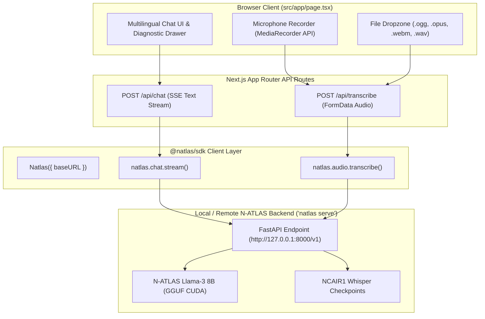

# N-ATLAS Sovereign AI Playground (Next.js)

[](https://nextjs.org)
[](https://www.typescriptlang.org)
[](https://tailwindcss.com)

The official web interactive demonstration playground for **N-ATLAS** (Nigeria's sovereign multilingual Large Language Model and Speech Recognition platform), powered directly by **`@natlas/sdk`**.

Built for the **National AI Innovation Challenge (NAIC 2026)** by NCAIR and NITDA under **Problem Statement 01: Developer Infrastructure** (Track B: Innovation & Enterprise).

---

## Architecture



---

## Features

- **Live Multilingual Streaming**: Real-time token streaming with automatic dialect system prompt injection across **Yorùbá, Hausa, Igbo, Nigerian English, and Pidgin**.
- **Tone Guard Toggle**: Interactive switch to demonstrate generation with and without dialect anti-drift guardrails.
- **In-Browser Voice Note Recording**: One-click microphone recording (`MediaRecorder` -> audio Blob) piped directly into the `@natlas/sdk` transcription pipeline.
- **Audio File Upload**: Drag-and-drop WhatsApp voice notes (`.ogg`, `.opus`), browser audio (`.webm`), or WAV files to transcribe with official `NCAIR1` Whisper checkpoints.
- **Clean App Router Architecture**: Modular Server and Client components using Next.js 14 App Router and Tailwind CSS.

---

## Local Development

Ensure your local `natlas serve` instance is running on `http://127.0.0.1:8000`:

```bash
# In terminal 1 (Python server):
cd natlas-python
natlas serve --port 8000
```

Then start the playground:

```bash
# In terminal 2 (Next.js playground):
cd natlas-playground
pnpm install
pnpm dev
```

Open [http://localhost:3000](http://localhost:3000) to view the playground in your browser.

---

## Production Build

```bash
pnpm build
pnpm start
```
